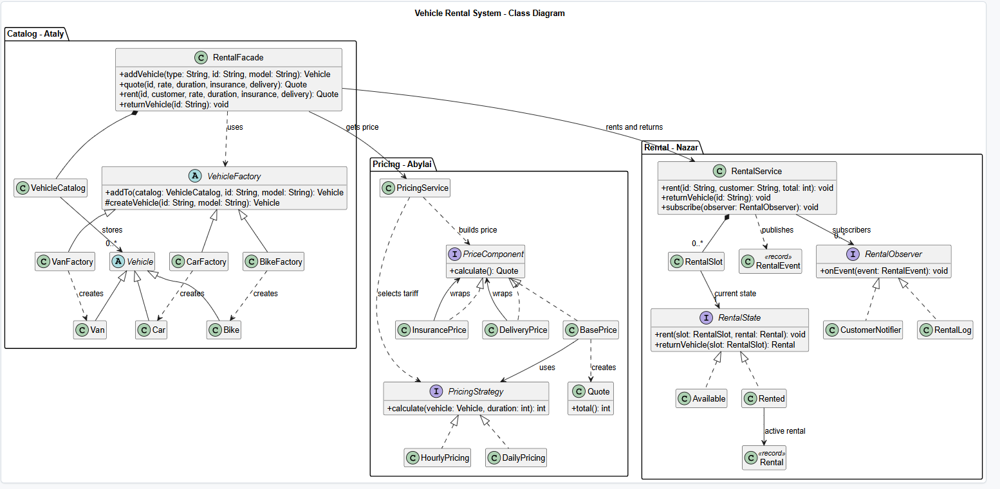
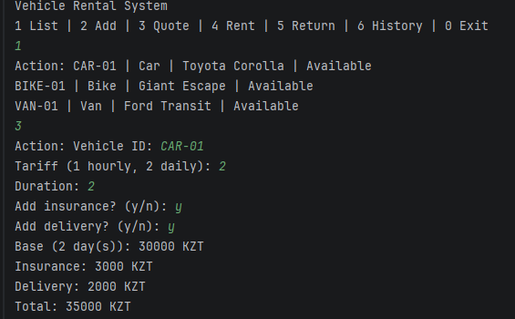
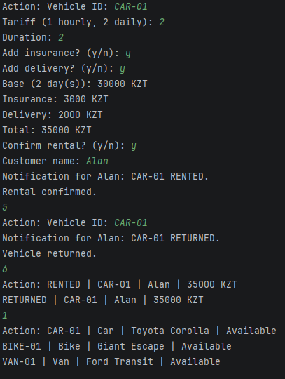
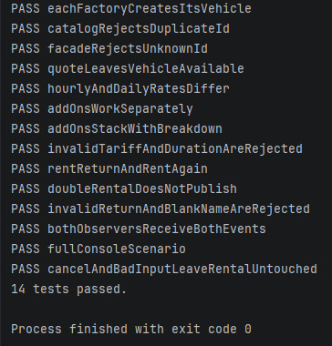

# Vehicle Rental System

A Java console application for renting cars, bikes, and vans. Users can add
vehicles, check availability, calculate a rental price, rent or return a
vehicle, and view the rental history.

The application stores data in memory. The catalog and rental history reset
when the program restarts.

## Team and design patterns

| Student | Package | Design patterns | What the code does |
| --- | --- | --- | --- |
| Ataly | `rental.ataly` | Factory Method, Facade | Creates vehicles through their own factories. `RentalFacade` connects the catalog, pricing, and rental services. |
| Abylai | `rental.abylai` | Strategy, Decorator | Uses different calculations for hourly and daily rates. Insurance and delivery can be added separately or together. |
| Nazar | `rental.nazar` | State, Observer | Controls when a vehicle can be rented or returned. After a successful action, the service notifies the customer and adds an event to the history. |

## Run in IntelliJ IDEA

1. Open the repository folder and select JDK 17 or newer.
2. Mark `src/main/java` as **Sources Root** and `src/test/java` as **Test Sources Root**.
3. Run `rental.Main` to start the application.
4. Run `rental.AllTests` to run the tests.

## Class diagram

The diagram shows how `RentalFacade` connects the catalog, pricing, and rental
parts. [PlantUML source](docs/class-diagram.puml)

## Demo

### Catalog and price

`CAR-01` costs 30,000 KZT for two days. Insurance adds 3,000 KZT and delivery
adds 2,000 KZT, for a total of **35,000 KZT**.

### Rent, return, and history

After the rental is confirmed, the program prints a customer notification.
When the vehicle is returned, it becomes available again. The history shows
both the `RENTED` and `RETURNED` events.

## Tests

All **14 tests passed**. They cover vehicle creation, pricing, rental state
changes, notifications, and the console workflow.

